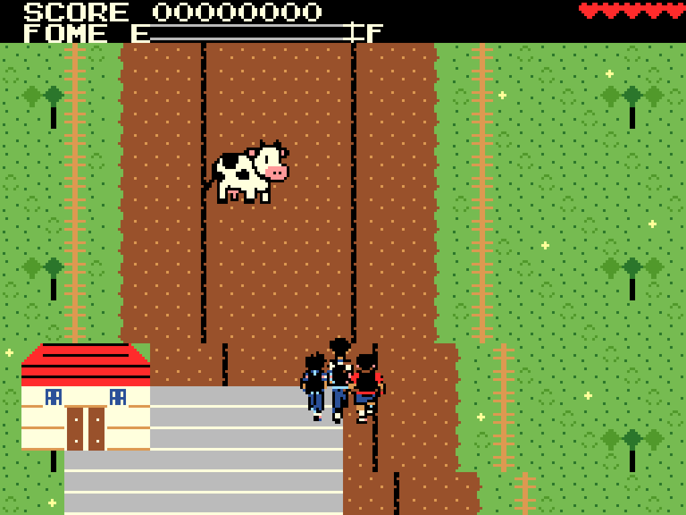
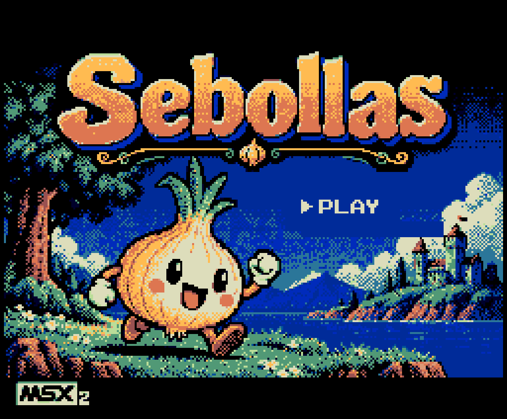

# Sebollas

Jogo de estrada rural para **MSX2**, escrito em **Assembly Z80**. Saia da casa do Vavá e viaje por três fases até o confronto com o garoto da garapa. Após vencê-lo, Argon, Gordinho (Leto) e Robson correm para pegar o ônibus de volta a Nova Iguaçu. A estrada de terra tem curvas para os dois lados, trechos estreitos, duas pontes sobre rios e dois postos de combustível. Buzine para tirar do caminho as vaquinhas paradas na estrada e recolha os queijos que rolam pela estrada.

A abertura usa **SCREEN 5, 256 × 212 pixels**, com a arte de referência convertida para 16 cores do MSX2. A partida usa **SCREEN 4, 256 × 192 pixels**, gráficos em tiles, sprites coloridos sobrepostos e áudio PSG, com uma melodia original de fundo. Os textos da partida reutilizam a fonte original do projeto.



## Jogar

Requisitos: MSX2 ou superior, ou emulador com BIOS compatível. Não funciona como jogo no MSX1; nesse modelo, a ROM apresenta a mensagem de que requer MSX2.

A imagem [Sebollas.rom](Sebollas.rom) é um cartucho de **64 KiB, com mapper ASCII8**, com cabeçalho `AB` e origem em `0x4000`.

```sh
openmsx -machine C-BIOS_MSX2 -cart Sebollas.rom -romtype ASCII8
```

No [WebMSX](https://webmsx.org/), carregue `Sebollas.rom` como cartucho em uma máquina MSX2 ou superior. A detecção automática seleciona ASCII8. Se houver uma seleção de mapper salva de uma versão anterior, escolha **ASCII8** no menu do cartucho.

| Controle | Ação |
| --- | --- |
| Espaço ou Enter, na abertura | Inicia `PLAY`. |
| Setas | Move o Fusca em oito direções, com limites laterais da área de jogo. |
| Espaço, na partida | Buzina no ritmo “bi, biiii”; pode ser mantido pressionado. |
| Espaço ou Enter, em GAME OVER ou nos créditos | Retorna à abertura. Solte a tecla antes de iniciar novamente. |

O jogo lê o teclado pela BIOS. Joystick físico não está selecionado nesta versão.

### Regras

- Após `PLAY`, o carro permanece parado, sem consumir combustível nem gerar obstáculos, até o primeiro comando de seta ou um novo pressionamento de Espaço. O Espaço usado no PLAY precisa ser solto primeiro.
- São **três fases**. Em cada uma, avance até o acesso da casa ao fim do percurso. As fases 1 e 2 mostram a contagem animada do bônus, uma transição de dois segundos e seguem automaticamente para a próxima.
- As fases mantêm a pontuação. Os queijos são convertidos em bônus ao final de cada etapa; a próxima começa com o contador zerado, tanque cheio e três corações. As paletas diferenciam cada etapa.
- Cada fase tem mais vacas paradas: os intervalos de geração caem de 128 para 80 e depois para 48 ticks, respeitando o limite gráfico e a separação vertical entre elas. As vacas entram em **Y=16, no topo da área de jogo abaixo do HUD**, e descem exatamente oito pixels junto com cada passo do cenário. Ao abastecer, o cenário e as vacas pausam juntos.
- Ao terminar o percurso da fase 3, o **garoto da garapa** lança canas na direção do carro. Desvie com as setas e buzine para atingi-lo. São necessárias **12 buzinadas completas**, e manter Espaço pressionado repete a sequência sem contar a mesma nota várias vezes.
- Depois da vitória, o Fusca estaciona e saem três garotos, com tamanhos e silhuetas diferentes. Eles correm atrás do ônibus para Nova Iguaçu, embarcam e dão lugar aos créditos. Antes dessa animação, os queijos da fase 3 também são somados ao placar, após derrotar o garoto da garapa.
- A estrada faz curvas sinuosas e se estreita antes das pontes. Sair da pista, atingir a margem ou entrar no rio custa uma vida e recoloca o carro no centro do trecho atual da estrada.
- O tanque começa cheio, com **100 unidades**, e gasta uma unidade a cada 6 ticks (cerca de 12 segundos por tanque, acompanhando a rolagem mais rápida). Tanque vazio encerra a partida.
- Existem **dois postos**, com bombas vermelhas e placas `POSTO`, à direita da estrada. Encoste no piso cinza junto às bombas para abastecer automaticamente; a rolagem pausa enquanto o tanque enche, acompanhada por pulsos sonoros que sobem de tom, inspirados no abastecimento de River Raid. O marcador `GAS`, inspirado em River Raid, tem escala `E`–`F` e ponteiro móvel. Abaixo de 21 unidades, o ponteiro fica vermelho e toca um alerta agudo de duas notas alternadas, no volume máximo do PSG; com 10 unidades ou menos o alerta fica mais rápido. A música cede o canal ao aviso, para ele permanecer audível. Abastecer interrompe os avisos.
- Uma musiquinha original, em estilo chiptune rural, toca em loop e em volume baixo durante a partida. Ela pausa para a buzina, o abastecimento e os alertas, retomando depois. A melodia acompanha o final e os créditos, e para na abertura ou em GAME OVER.
- O jogador começa com **três corações vermelhos**, que se apagam a cada batida.
- Cada batida retira uma vida e concede **dois segundos de invulnerabilidade**, com o carro piscando.
- A terceira batida mostra `GAME OVER` no centro do cenário da partida, mantendo a pontuação final no HUD.
- A buzina está uma oitava acima da versão anterior e toca um “bi” curto de 120 ms, uma pausa de 80 ms e um “biiii” longo de 480 ms, sem efeito visual. As vacas ficam paradas no meio da estrada até ouvirem a buzina. Ela alcança imediatamente as vacas próximas à frente do carro, que saem para uma das margens e liberam a passagem. A vaca usa uma pose fixa, espelhada conforme a direção, sem animação ao andar.
- Queijos redondos, com fundo transparente, descem pela pista, girando e acompanhando suas curvas. Encoste o Fusca para recolhê-los. O painel mostra **QUEIJOS** com a quantidade, na segunda linha à direita do combustível, inclusive durante o abastecimento. Cada queijo vale **100 pontos**, creditados somente ao final da fase, sem somar duas vezes. Deixar um queijo passar não tira vida.
- Na tela de bônus, o contador de queijos diminui um por vez, enquanto o bônus e o placar sobem de 100 em 100, com um bip por unidade e um acorde final. A fase 3 faz essa contagem depois do confronto da garapa.
- Cada vaca espantada vale **100 pontos**, concedidos uma única vez.
- Existem no máximo duas vacas e um queijo visíveis. A dificuldade é fixa.
- As duas linhas superiores mostram a pontuação de oito dígitos, as vidas, o combustível e o trajeto; somente o cenário abaixo delas rola.

## Abertura



A abertura preserva o título, a cebola, a vegetação e a paisagem da imagem em `resources/title-reference.png`. A paleta é convertida para 16 cores de 3 bits por canal. No lugar das opções decorativas do anexo, há somente `PLAY`, que pisca sobre a paisagem, sem instruções adicionais. A transição exige que Espaço/Enter tenham sido soltos antes de um novo pressionamento, evitando reinícios e disparos involuntários.

## Três prévias

As prévias abaixo são renderizadas dos **mesmos padrões de tiles, máscaras de sprites e fonte que entram na ROM**. Cada arquivo tem uma versão nativa de 256 × 192 e uma ampliação de 1024 × 768 sem suavização. A composição é ilustrativa de uma situação de gameplay, com pontuação de exemplo.

| Direção visual | Nativa | Ampliação 4× |
| --- | --- | --- |
| Pasto verde, estrada marrom, Fusca amarelo — visual da ROM | [256 × 192](previews/01-pasto-fusca-amarelo.png) | [1024 × 768](previews/01-pasto-fusca-amarelo-4x.png) |
| Terra vermelha e Fusca azul | [256 × 192](previews/02-terra-vermelha-fusca-azul.png) | [1024 × 768](previews/02-terra-vermelha-fusca-azul-4x.png) |
| Fazenda seca e Fusca vermelho | [256 × 192](previews/03-fazenda-seca-fusca-vermelho.png) | [1024 × 768](previews/03-fazenda-seca-fusca-vermelho-4x.png) |

As duas alternativas mudam a paleta dos mesmos gráficos. O jogo usa a primeira direção; não há seletor de temas na abertura.

A [exploração artística inicial](previews/conceito-rural.png) foi gerada com a ferramenta integrada **Image Gen**, usando este [prompt](previews/conceito-prompt.txt). Ela orienta a composição e não representa uma captura do MSX. As três prévias finais são produzidas pelo renderizador determinístico do projeto.

## Compilar

Os recursos binários de montagem já estão em `resources/generated/`. Para montar a ROM, basta **SjASMPlus** disponível no `PATH`, executado a partir desta pasta:

```sh
sjasmplus Sebollas.asm
```

No PowerShell, usando a distribuição do assembler na pasta superior:

```powershell
..\sjasmplus.exe Sebollas.asm
```

A diretiva `OUTPUT` substitui `Sebollas.rom`. O cartucho usa oito bancos de 8 KiB no mapper ASCII8, totalizando 65.536 bytes. O banco 0 mantém todo o código fixo; os bancos 1 a 3 contêm os recursos da partida; os bancos 4 e 5 guardam a abertura; os bancos 6 e 7 são reservados. A janela 6000–7FFF permanece no banco 1, enquanto as janelas 8000–9FFF e A000–BFFF alternam entre os recursos da partida e da abertura. O fonte verifica os limites de cada janela com `ASSERT`.

A montagem foi validada com **SjASMPlus 1.21.0**, sem erros ou avisos.

### Recriar os gráficos

Python 3 e Pillow são necessários somente para editar/recriar os recursos, gerar prévias e executar os testes Python. Não são dependências da ROM nem da montagem com os binários existentes.

```sh
python3 tools/build_assets.py
python3 tools/build_title.py
sjasmplus --sym=resources/generated/sebollas.sym Sebollas.asm
python3 tools/render_previews.py
```

A fonte original de 39 caracteres está preservada em `resources/font-original.bin`. O gerador remapeia seus desenhos para os códigos ASCII corretos, separa os tiles de cenário e gera as máscaras de sprites e suas cores por linha.

Também há alvos de Make:

```sh
make                  # monta a ROM e gera símbolos para o depurador
make assets           # recria recursos binários
make previews         # recria as três prévias e ampliações
make test             # montagem e testes de recursos
make test-emulator    # rotinas Z80 e gameplay contínuo em 50/60 Hz
make captures         # capturas reais de abertura, jogo e GAME OVER
```

O teste opcional no WebMSX usa Node.js 18+, Chrome e `playwright-core`. Ele acessa o emulador público, carrega a ROM local sem forçar o mapper e verifica abertura, bancos de recursos, espera inicial, direção, scroll e buzina em MSX2+ de 50 e 60 Hz:

```sh
npm install --prefix /tmp/sebollas-webmsx-test playwright-core
NODE_PATH=/tmp/sebollas-webmsx-test/node_modules node tests/webmsx_smoke.cjs
```

Use `CHROME_PATH` se o Chrome estiver fora de `/usr/bin/google-chrome`. As capturas são gravadas em `previews/title-webmsx-*.png` e `previews/game-webmsx-*.png`.

## Organização

| Arquivo ou pasta | Responsabilidade |
| --- | --- |
| `Sebollas.asm` | Cabeçalho, configuração do vídeo, estados, controles, buzina, vacas, colisões, cenário e composição dos sprites. |
| `campaign.asm` | Partida parada até o primeiro comando, três fases, garoto da garapa, canas, ônibus, três corredores e créditos. |
| `route.asm` | Combustível, abastecimento, colisão com terreno, chegada e marcador com ponteiro. |
| `cheese.asm` | Queijos rolando, coleta pendente de bônus e contador no HUD. |
| `bonus.asm` | Conversão animada dos queijos em 100 pontos por unidade, som de contagem e acorde final. |
| `bios.asm` | Endereços da BIOS e das tabelas de vídeo. |
| `title.asm` | Abertura em SCREEN 5, descompressão RLE direta para VRAM e PLAY piscando. |
| `tools/build_title.py` | Conversão da referência para a paleta do MSX2, bitmap e compressão da abertura. |
| `ram_vars.asm` / `initRAM.asm` | Mapa e inicialização explícita da RAM e reinício da partida. |
| `string.asm` | Impressão por coordenadas, conversão BCD e desenhos originais da fonte. |
| `math.asm` | Rotinas aritméticas; a soma BCD é usada pela pontuação. |
| `music.asm` | Melodia original de 32 eventos, em loop, com prioridade para os efeitos sonoros. |
| `sfx.inc` | Efeitos PSG nos três canais e desligamento por contagem de ticks. |
| `tools/build_assets.py` | Fonte, tiles rurais, curvas do mapa, paletas, carro, vacas, queijos transparentes e poeira. |
| `tools/render_previews.py` | Composição das prévias com os recursos reais. |
| `resources/generated/` | Binários usados na ROM e dados locais de verificação. |
| `tests/` | Restrições de hardware, testes das rotinas no openMSX e capturas. |
| `previews/` | Três estilos, conceito artístico e capturas do emulador. |

`keyboard.asm`, `bitset.asm`, `sprites.spr` e os antigos arquivos de mapa/bitmaps continuam disponíveis como material do protótipo anterior, mas não são incluídos pela nova ROM. O arquivo vazio `32k` também não participa da montagem.

## Limites gráficos e implementação

O cenário usa tiles de 8 × 8, com dois índices de cor por linha de oito pixels. O centro da pista varia até 64 pixels entre as curvas, e os queijos acompanham esses deslocamentos. O mapa tem 160 linhas, com início na linha 138 e fim na linha 0, sem repetição; a janela de 22 linhas avança oito pixels a cada 8 ticks, o dobro da velocidade anterior. O deslocamento lateral do carro também acompanha esse aumento. O percurso leva cerca de 22 segundos, mais o tempo de abastecimento e de aproximação final. Os bancos gráficos recebem a mesma fonte e os mesmos tiles, permitindo imprimir nas três regiões verticais.

| Elemento | Composição |
| --- | --- |
| Fusca 16 × 32 | Seis sprites: três camadas em cada metade de 16 × 16. |
| Vaca 32 × 32 | Oito sprites: duas camadas por quadrante, com combinação de cores CC para conservar preto, branco e rosa da imagem `resources/cow-reference.png`. Uma pose fixa, nos dois sentidos. |
| Poeira | Um sprite de 16 × 16, com quatro quadros, colocado logo após a traseira. |
| Queijo | Um sprite transparente de 16 × 16, com dois quadros de rotação. |

As vacas ficam separadas verticalmente por pelo menos 48 pixels. Carro e poeira não compartilham linhas. Assim, o pior caso usa quatro entradas de uma vaca, três do carro e uma do queijo: **oito sprites por linha**, sem alternância de camadas por excesso. A piscada de invulnerabilidade é intencional.

O jogo usa **58 padrões de 16 × 16**. A estrada tem no máximo **24 entradas de sprite**; o confronto e a animação final também respeitam os limites de 32 entradas e oito sprites por linha. A RAM de trabalho fica em `0xC000–0xC6FF`; os atributos e cores são preparados em RAM antes do envio à VRAM.

| VRAM | Uso |
| --- | --- |
| `0x0000–0x17FF` | Três bancos de padrões de tiles. |
| `0x1800–0x1AFF` | Name Table de 32 × 24. |
| `0x1C00–0x1DFF` | Cores dos sprites por linha. |
| `0x1E00–0x1E7F` | Atributos dos sprites. |
| `0x2000–0x37FF` | Três bancos de cores dos tiles. |
| `0x3800–0x3FFF` | Padrões dos sprites. |

A combinação de cores da vaca usa o bit CC do V9938: preto 6, rosa 9 e branco 15 por OR, conforme o [manual técnico da Yamaha](https://map.grauw.nl/resources/video/yamaha_v9938.pdf).

A lógica roda a 50 ticks por segundo. Em vídeo de 60 Hz, um de cada seis VBlanks não avança a lógica. As colisões usam caixas reduzidas em software: a sobreposição das camadas do carro, a poeira e a área da buzina não provocam batidas.

## Verificação realizada

- Montagem sem erros ou avisos; cartucho ASCII8 de 64 KiB.
- **WebMSX 6.0.8 no Chrome**, em MSX2+ de 50 e 60 Hz: detecção automática ASCII8, abertura em SCREEN 5, transição para SCREEN 4, bancos de recursos, espera pelo primeiro comando, movimento, scroll e buzina. A campanha completa foi validada no openMSX.
- **Doze testes Python**: fonte original, paletas, endereços de VRAM, máscaras, direções e fidelidade às cores da vaca, percurso e pontos de interesse, ROM, compressão da abertura, texto integral dos créditos, tamanhos dos três corredores e limite de sprites.
- **144 casos de rotinas Z80 em cada frequência**, no openMSX 17.0 com C-BIOS MSX2 de 50 e 60 Hz: oito direções, bordas, alcance da buzina, vacas, abertura em SCREEN 5, transição para a partida, pontuação BCD, três vidas, invulnerabilidade, menu, áudio, combustível, alerta, marcador, sequência da buzina, som de abastecimento, música e prioridade dos efeitos, coleta de queijos, postos, pontes, terreno e chegada, espera inicial, sequência das fases, canas, resistência do chefe, embarque, créditos e limite de sprites da animação, entrada das vacas no topo, sincronismo com o cenário e soma animada dos queijos.
- Dois testes contínuos de aproximadamente 30 segundos, com direção e buzina: **zero quadros com excesso de sprites**, máximo observado de oito por linha.
- Duas viagens da fase 1, em 50 e 60 Hz, isolando o percurso e os dois postos das batidas com vacas.
- **Duas campanhas completas por comandos de teclado, sem alterar vida, combustível, posição ou resistência do chefe**: três fases, seis postos, 12 acertos de buzina no chefe, corrida atrás do ônibus e chegada aos créditos. Os testes verificam um número crescente de vacas, as três telas de bônus e cada conversão de queijo em exatamente 100 pontos, com zero excesso de sprites em 50 e 60 Hz.
- Capturas reais de [abertura](previews/abertura-openmsx.png), [gameplay](previews/gameplay-openmsx.png) e [GAME OVER](previews/gameover-openmsx.png), além de [ponte](previews/ponte-openmsx.png), [posto](previews/posto-openmsx.png) e [chegada](previews/chegada-openmsx.png), além de uma [cena com queijo transparente e vaca](previews/queijos-openmsx.png), [garapa](previews/garapa-openmsx.png), [corrida até o ônibus](previews/onibus-openmsx.png) , [créditos](previews/creditos-openmsx.png) e [contagem animada do bônus](previews/bonus-openmsx.png).
- Comparação da VRAM capturada com os padrões, cores, paleta e fonte empacotados na ROM; comparação completa do bitmap e da paleta da abertura com os recursos convertidos, respeitando a área piscante do PLAY.

Os relatórios locais são gerados em `resources/generated/emulator-50.txt`, `emulator-60.txt`, `stress-50.txt`, `stress-60.txt`, `route-50.txt`, `route-60.txt`, `campaign-50.txt` e `campaign-60.txt`. O teste de áudio verifica os registradores e o desligamento dos canais; não houve avaliação auditiva ou teste em hardware físico.

Neste ambiente, o openMSX precisa ser executado fora do sandbox para iniciar corretamente. Esse requisito é do ambiente de desenvolvimento, não da ROM.

## Créditos finais

A tela usa fonte bitmap de 8 × 8 no estilo Konami, baseada nos caracteres do projeto e complementada com minúsculas, pontuação e acentos. O texto, preservado com quebra de linhas, é:

> Essa foi a aventura de Argon, Gordinho (Leto) e Robson em sua jornada de Nova Iguaçu até o Sebollas.
>
> Obrigado amigos, pelas boas memórias.
>
> By Robson Velloso

## Licença

O projeto ainda não inclui arquivo de licença. As condições de uso e redistribuição do código e dos recursos precisam ser definidas pelo responsável.
